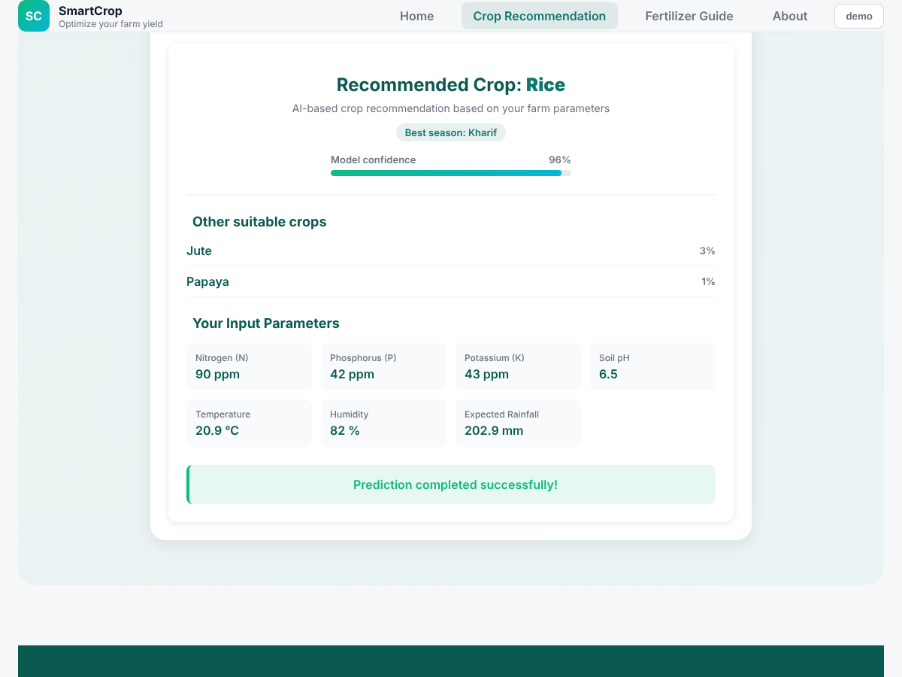

# 🌱 SmartCrop – Crop Recommendation

Enter your soil (N, P, K, pH) and weather (temperature, humidity, rainfall) values and SmartCrop recommends the best crop out of **22 crops**, with the model's confidence and the next best options.

**Live demo:** _paste your Render link here_  (login: `demo` / `demo123`, or sign up)



## Tech stack
| Layer | Tech |
|---|---|
| Frontend | HTML, CSS, JavaScript |
| Backend | Spring Boot 3 (Java 17), Spring Security + JWT, Spring Data JPA |
| ML API | Flask, scikit-learn Random Forest (22 crop classes) |
| Database | H2 (default) / MySQL (optional) |
| Deploy | Docker (one container: Flask + Spring Boot) |

## Architecture
```
Browser ──> Spring Boot (serves the website + /api/*, JWT login) ──> Flask ML API (/predict)
```

## Run locally
1. **Flask** (port 5001)
   ```
   cd flask-api
   pip install -r requirements.txt
   python mi_api.py
   ```
2. **Spring Boot** (port 8080) – open `backend` in STS/IntelliJ and run `SmartCropApplication`, or `cd backend && mvn spring-boot:run`
3. Open **http://localhost:8080** – the backend serves the website too.

Optional MySQL: copy `backend/src/main/resources/application-local.properties.example` to `application-local.properties`, put your password there and run with profile `local`. That file is git-ignored.

## Push to GitHub
```
git init
git add .
git commit -m "SmartCrop: crop recommendation"
git branch -M main
git remote add origin https://github.com/<your-username>/smartcrop.git
git push -u origin main
```
GitHub only stores the code. To get a link that opens the working app, deploy it (below).

## Deploy (Render, free)
1. Render → **New → Web Service** → connect this GitHub repo.
2. Runtime: **Docker** (it finds the `Dockerfile`). Instance type: Free.
3. Environment variable: `JWT_SECRET` = any long random string (32+ chars).
4. Health check path: `/api/health`.
5. Deploy. Your link is `https://<name>.onrender.com`.

Free-tier notes: the app sleeps after ~15 min idle (first open takes ~1 min), memory is only 512 MB, and the H2 database resets on each redeploy/restart, so signed-up users may disappear (the `demo` user is recreated automatically). For a persistent database use a hosted MySQL/Postgres and set the datasource variables.

## API
| Method | Path | Notes |
|---|---|---|
| POST | `/api/auth/register` | `{username, password}` |
| POST | `/api/auth/login` | returns JWT |
| POST | `/api/crops/recommand` | Bearer token; `{n,p,k,temperature,humidity,ph,rainfall}` |
| GET | `/api/history` | last 20 predictions of the user |
| GET | `/api/health` | backend + Flask status |
